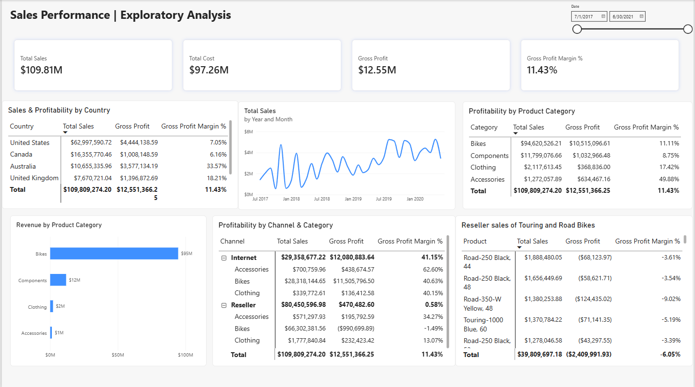
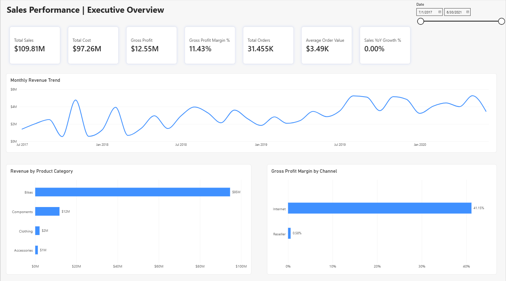
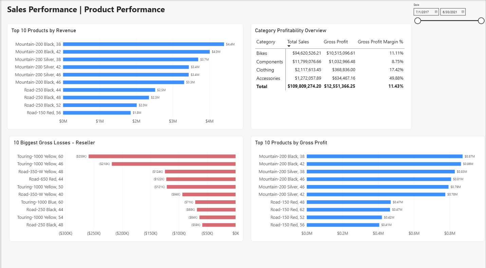
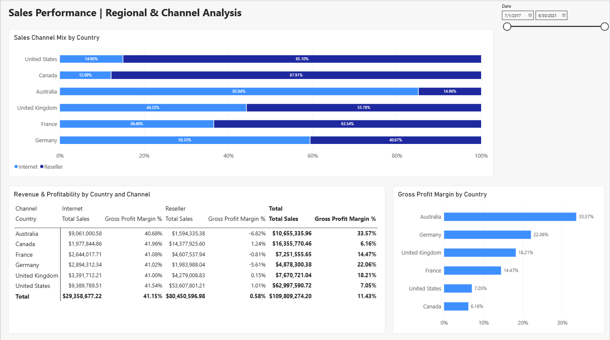

# Sales Performance Analysis & Dashboard

**An interactive Power BI sales analytics project using Microsoft's AdventureWorks sample data.**

This project examines sales trends, product performance, gross profitability, and differences across sales channels and geographic markets. The objective is to turn transaction-level data into an accessible dashboard and evidence-based business recommendations.

**Tools:** Excel · Power Query · Power BI · DAX  
**Data source:** [Microsoft AdventureWorks Sales Sample](https://github.com/microsoft/powerbi-desktop-samples/blob/main/AdventureWorks%20Sales%20Sample/AdventureWorks%20Sales.xlsx)  
**Report:** [Open the Power BI file](sales_performance_analysis.pbix)

## Dashboard Preview

### 1. Exploratory Analysis

An exploratory workspace used to investigate sales performance, validate KPI calculations, and identify profitability patterns across product categories, sales channels, countries, and individual products.

The page includes revenue trends, category and geographic profitability comparisons, channel-level analysis, and detailed investigations into loss-making products.



### 2. Executive Overview

Tracks sales, product cost, gross profit, gross margin, order count, average order value, monthly revenue, and performance by product category and sales channel.



### 3. Product Performance

Compares the top 10 products by revenue and gross profit, summarizes category profitability, and identifies products with the largest gross losses in the Reseller channel.



### 4. Regional & Channel Analysis

Compares gross margins across countries, shows the Internet/Reseller revenue mix, and provides a detailed country-by-channel profitability breakdown.




## Business Questions

- How have sales changed over time?
- Which categories and products drive the most revenue and gross profit?
- Which products contribute the largest gross losses?
- How do Internet and Reseller channels differ in gross profitability?
- How does sales-channel mix vary by country, and how is it associated with gross margins?

## Data and Model

The project uses Microsoft's **fictional** AdventureWorks Sales workbook. The analyzed data contains **121,253 sales order lines** across the period **July 1, 2017–June 15, 2020**. A sales order can contain multiple lines, so order counts use distinct order identifiers.

Seven source tables were imported:

| Table | Purpose |
| --- | --- |
| `Sales` | Order-line transactions, revenue, quantity, and product costs |
| `SalesOrder` | Order identifiers and sales channels |
| `Product` | Product names, categories, and subcategories |
| `Customer` | Customer attributes |
| `Reseller` | Reseller attributes |
| `Date` | Calendar attributes for time analysis |
| `SalesTerritory` | Geographic sales territories |

The model connects the central `Sales` fact table to the related descriptive tables.

## Approach

1. **Explore:** Reviewed the Excel tables, their structure, and key sales metrics.
2. **Profile:** Used Power Query to check column types, uniqueness, missing values, and errors.
3. **Preserve meaningful data:** Retained `-1` *Not Applicable* customer/reseller keys and sales lines with missing shipping dates instead of deleting potentially valid transactions.
4. **Model:** Established relationships between sales transactions and the corresponding date, product, customer, reseller, order, and territory data.
5. **Measure:** Created reusable DAX calculations for revenue, cost, gross profit, gross margin, orders, and average order value.
6. **Analyze and visualize:** Built interactive report pages and investigated low-margin channels, regions, categories, and individual products.
7. **Validate:** Cross-checked dashboard totals and tested date slicers, chart interactions, and product rankings.


## Key Performance Indicators

*Full available sales period; figures are rounded.*

| KPI | Value |
| --- | ---: |
| Total Sales | **$109.81M** |
| Total Product Cost | **$97.26M** |
| Gross Profit | **$12.55M** |
| Gross Profit Margin | **11.43%** |
| Distinct Sales Orders | **31,455** |
| Average Order Value | **$3.49K** |

### Core DAX Measures

```dax
Total Sales =
SUM('Sales'[Sales Amount])

Total Cost =
SUM('Sales'[Total Product Cost])

Gross Profit =
[Total Sales] - [Total Cost]

Gross Profit Margin % =
DIVIDE([Gross Profit], [Total Sales], 0)

Total Orders =
DISTINCTCOUNT('SalesOrder'[Sales Order])

Average Order Value =
DIVIDE([Total Sales], [Total Orders], 0)
```

These measures recalculate under the report's date, product, territory, and channel filters.


See [Business Insights & Recommendations](insights.md) for additional interpretation and follow-up questions.


The `datasets/` directory is used for local input files. The original Excel workbook is available from the Microsoft source link above; it is not required to be committed to this repository. An additional screenshot of the Exploratory Analysis page may also be kept in `screenshots/`.

## Open the Report

1. Install [Power BI Desktop](https://www.microsoft.com/en-us/power-platform/products/power-bi/desktop).
2. Clone or download this repository.
3. Open [`sales_performance_analysis.pbix`](sales_performance_analysis.pbix).
4. If Power BI requests the original Excel source, download [AdventureWorks Sales.xlsx](https://github.com/microsoft/powerbi-desktop-samples/blob/main/AdventureWorks%20Sales%20Sample/AdventureWorks%20Sales.xlsx), save it locally (for example, under `datasets/`), update the Excel source path in Power Query, and refresh the data.
5. Explore the Executive Overview, Product Performance, and Regional & Channel Analysis pages using the date slicers and interactive visuals.


## Attribution

The dataset comes from [Microsoft's Power BI Desktop Samples — AdventureWorks Sales](https://github.com/microsoft/powerbi-desktop-samples/tree/main/AdventureWorks%20Sales%20Sample). 
